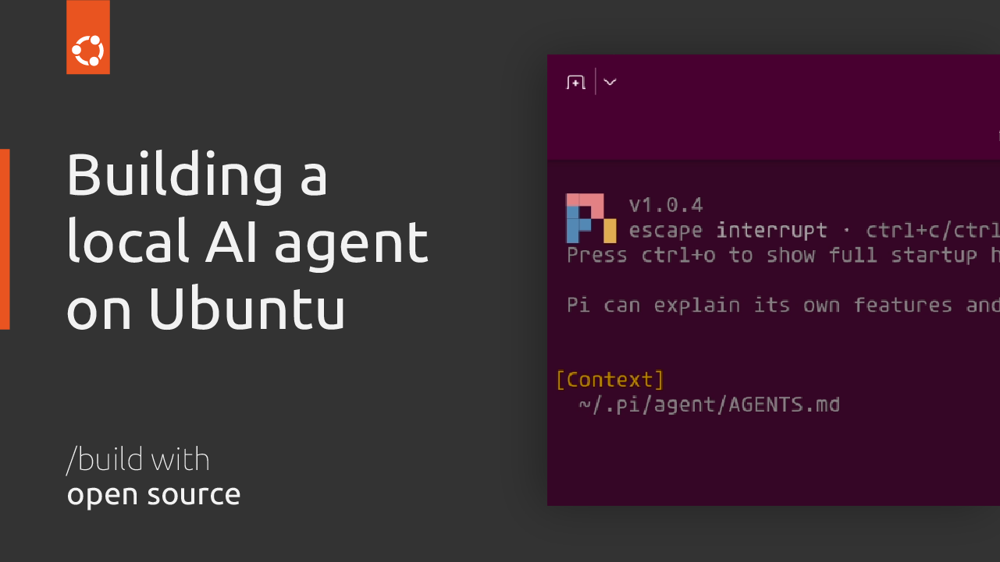

# Building a local AI agent in Workshop on Ubuntu



Contents:
- `workshop.yaml`: [Workshop](https://ubuntu.com/workshop) definition, including the [Pi coding agent SDK](https://github.com/canonical/pi-sdk)
- `models.json`: Pi configuration for a local [Qwen3-Coder inference snap](https://github.com/canonical/qwen3-coder-snap)

Usage:

```
$ sudo snap install qwen3-coder
$ qwen3-coder engines  # Make sure it's using the best one for your hardware
$ sudo snap install workshop
$ sudo snap install lxd --channel=6/stable
$ workshop launch
$ workshop connect dev/pi:llm-endpoint dev/system:llm-endpoint
$ workshop shell
(workshop) $ vim ~/.pi/agent/models.json  # Paste contents of `models.json`
(workshop) $ exit
$ workshop run pi
```
